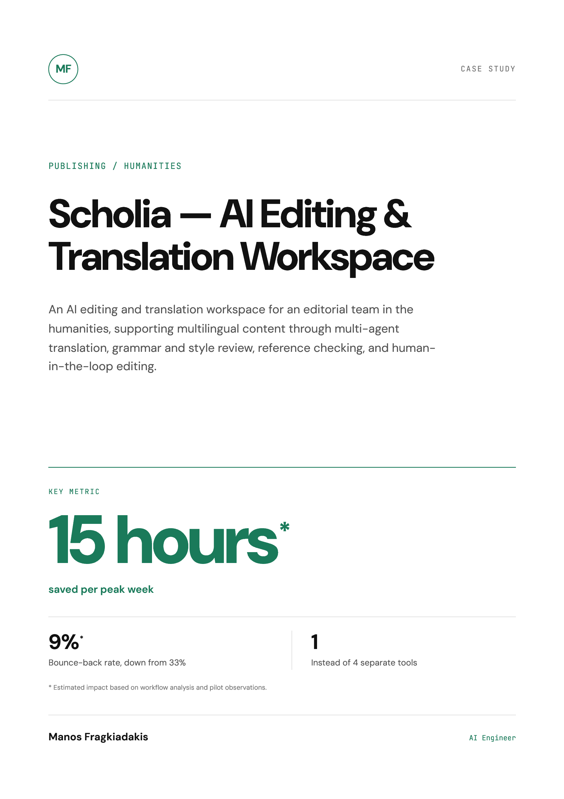
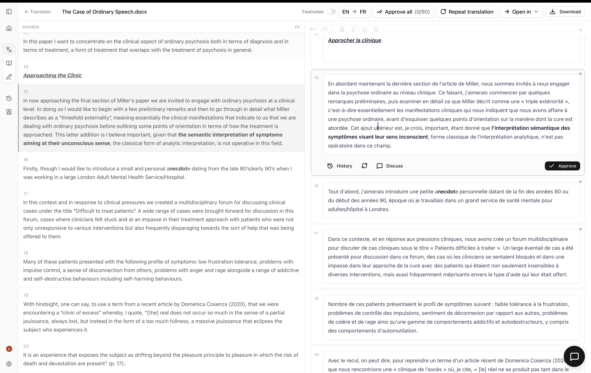
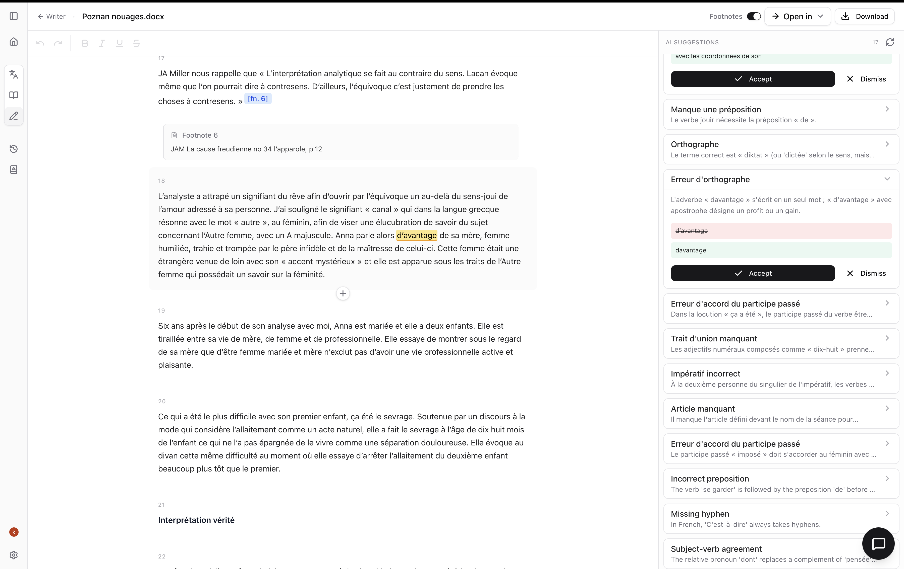
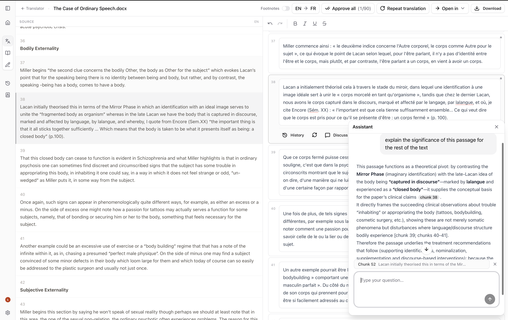

# Scholia — AI Editing & Translation Workspace

**An AI editing and translation workspace for a humanities editorial team, combining multi-agent translation, grammar and style review, reference checking, and human-in-the-loop editing.**

## At a glance

| Result | What it means |
| --- | --- |
| **15 hours saved\*** | Estimated time saved per peak week |
| **9% bounce-back\*** | Estimated rate of articles returned for rework, down from 33% |
| **1 workspace** | Instead of four separate tools |

\* Estimated impact based on workflow analysis and pilot observations.

## The situation

A small editorial team at a humanities research institute prepared around 16 articles a week ahead of conferences and volume releases. Editing happened in Word, while translation, grammar, and reference work were spread across separate tools and subscriptions.

Generic translation tools did not respect the discipline's terminology, the journal's style, or its formatting conventions. Errors reached the review stage, and 33% of articles came back needing rework. During peak weeks, the work spilled into evenings and Saturdays.

## What I built

I built Scholia — AI editing and translation software designed around the team's existing editorial process.

Translation uses a **translator → reviewer → human editor** chain. A translator agent works segment by segment with a custom glossary tuned to the discipline's terminology and journal style, recording a short note when it makes a judgment call. A reviewer agent then checks the complete translation for consistency of terms and style and corrects errors.

The human editor approves each segment into the working draft, edits it, or leaves feedback. Feedback returns to the reviewer with the segment's full history; any revised segment goes back to the editor for approval.

*Document-level translation. The editor approves each segment into the working draft.*

During the main edit, Scholia flags grammar, expression, and style issues inline. The editor can accept, edit, or reject each suggestion.

*Inline grammar suggestions in the main edit. The editor accepts, edits, or rejects each one.*

Scholia also cross-checks references and claims against the team's uploaded sources and provides a cited Q&A assistant for questions about the document. The editor retains control over every change.

*Ask the assistant about a passage or idea. It draws on the article and the uploaded literature.*

## How it works

| Step | What happens |
| --- | --- |
| **Translate** | A translator agent processes the article segment by segment, using a custom glossary and noting judgment calls. |
| **Review** | A reviewer agent checks the full translation for consistent terminology and style, correcting errors. |
| **Approve** | The human editor approves, edits, or provides feedback on each segment. Revisions return for approval with the segment history intact. |
| **Edit** | Inline grammar, expression, and style suggestions are presented for editorial review. |
| **Check sources** | Reference and claim checks use uploaded sources; a cited Q&A assistant answers questions about the document. |

**Core capabilities:** NLP · Agentic editing · Multi-agent translation · Human-in-the-loop · Custom glossary

**Tech stack:** FastAPI · LangGraph · Next.js · PostgreSQL · Microsoft Foundry / Azure

## Results

- **15 hours saved per peak week**, without adding headcount.
- **9% bounce-back rate, down from 33%**, reducing the share of articles returned for rework.
- **One editing workspace instead of four separate tools**, bringing translation, grammar, and reference work into the same editing process.

The workflow analysis and pilot observations also indicated that peak weeks no longer required evenings and Saturdays.

*Estimated impact based on workflow analysis and pilot observations.*

> I came in skeptical about AI. But Manos built this so every change goes through an editor and the AI doesn't make changes without approval.
>
> — Editorial Director, humanities research institute

## Full case study

The designed case study is available as a PDF: [Scholia — AI Editing & Translation Workspace](ai-editing-translation.pdf).

## About Manos

Manos Fragkiadakis is an Applied AI Engineer building document intelligence and AI knowledge systems. He has over five years of Python software development experience and has built custom ERP and CRM systems for professionals. His recent work includes cited RAG across 3,000+ page legal case files and court-monitoring automation software used by 10+ law offices. He previously worked as an AI engineer and taught Natural Language Processing at Utrecht University.

[GitHub](https://github.com/emfrg)
